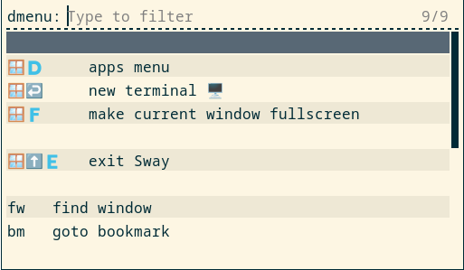

# sway helper scripts

Some scripts to help me work with sway

## Overview

These scripts use (rofi)[https://github.com/davatorium/rofi] to show and run frequently used sway commands and key-sequences in menus.  

Menus can be stored in text files such as the following


sway.menu
```
🪟🇩     apps menu || rofi -show drun -show-icons 
🪟↩️     new terminal 🖥️ || swaymsg exec foot

🪟⬆️🇪   exit Sway || ~/.local/bin/sway/_mymenu ~/.local/bin/sway/exit.menu


fw   find window || ~/.local/bin/sway/_my_choose_window 
bm   goto bookmark || ~/.local/bin/sway/_my_goto_bookmark 
```

and displayed using 
```bash
 $ _mymenu [flags] ~/.local/bin/sway.menu
   -t --type  run / text
```



The key sequences shown are for information only - they should match the ones defined in ~/.config/sway/config.   Choosing them from the menu actually runs the command shown after the double pipe symbol. In the case of 'fw' for find window,  the 'kw' is there so that you can enter 'kw' to select the command quickly (in the menu only).


Additional Features:

  * lines beginning with "#" are comments and are not displayed
  * empty lines reduced to single empty line and are non-selectable
  * Lines beginning ":" are shown without the ":" and are non-selectable
  * lines may contain simple markup (rofi supports pango)
  * lines beginning with @ before the first menu content can be used to   
 provided additional switches to rofi.
